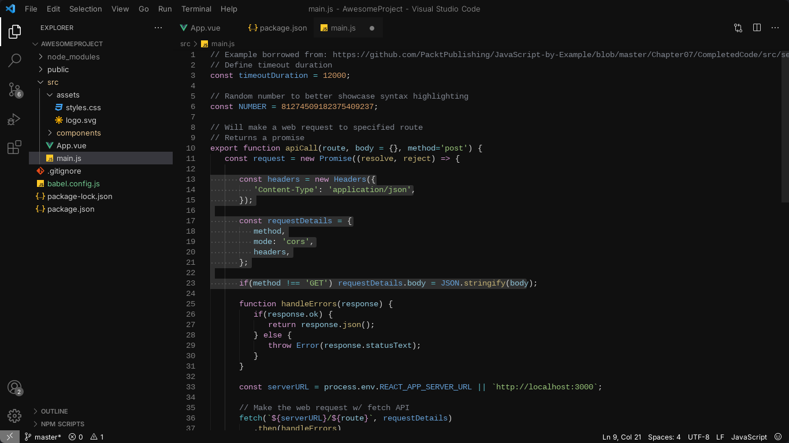
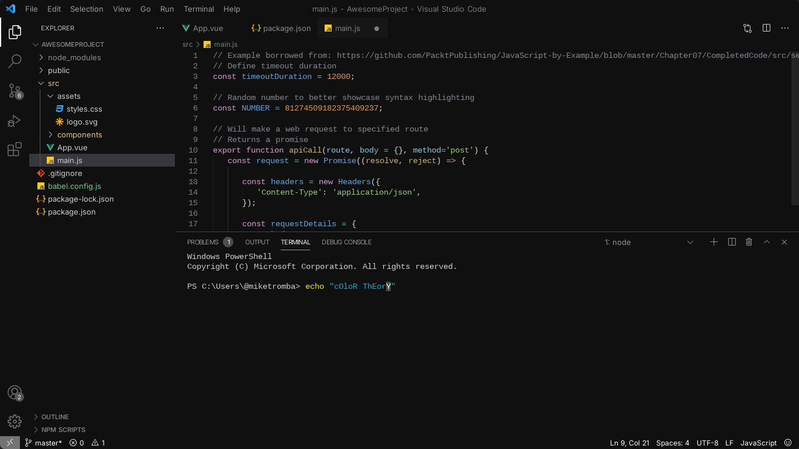
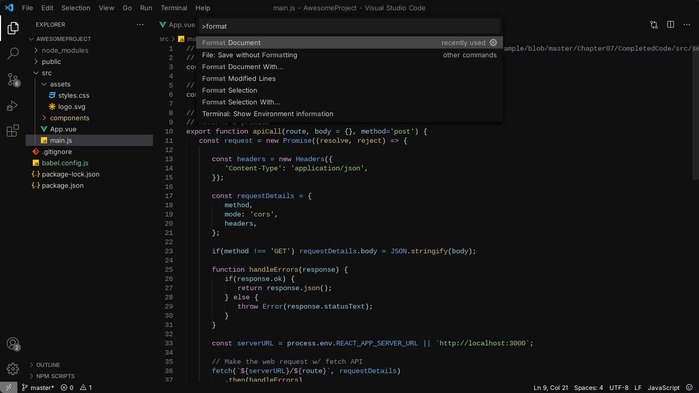

## Preview





## Installation

Download the `.vsix` package from the [Releases](https://github.com/sbacs/vsCode-Theme/releases) section.

In VS Code:
1. Open the **Extensions** tab.
2. Click the three-dot menu (`...`).
3. Select **Install from VSIX...**.
4. Select the downloaded `.vsix` file.

## Manual Installation

Clone the repository:

```bash
git clone https://github.com/sbacs/vsCode-Theme.git
```

Install the VS Code Extension packaging tool:

```bash
npm install -g @vscode/vsce
```

Navigate to the cloned repository:

```bash
cd vsCode-Theme
```

Generate the `.vsix` package:

```bash
vsce package
```

Once generated, install the `.vsix` file following the instructions above.